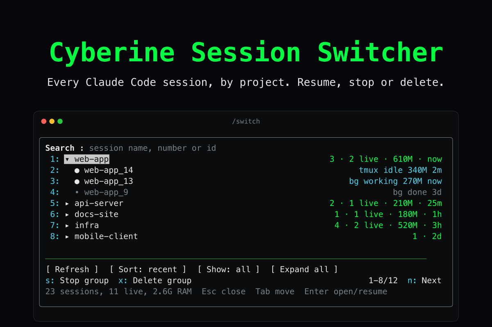
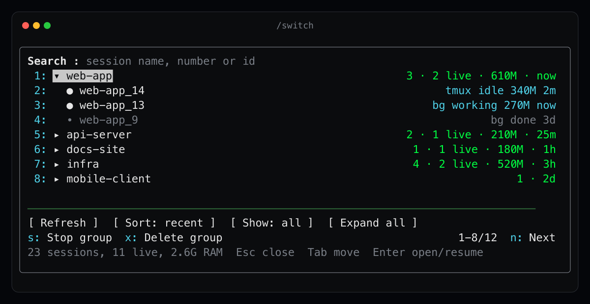
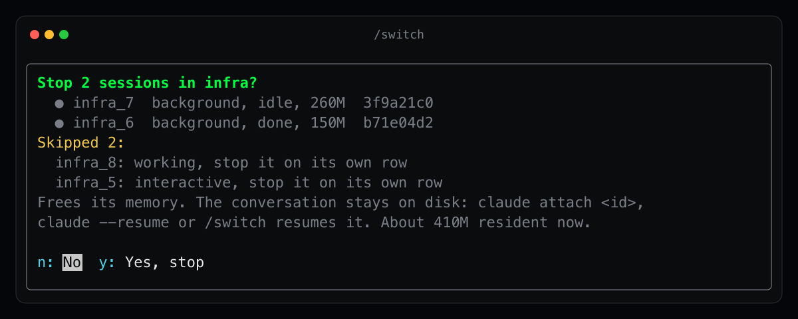

# Cyberine Session Switcher



A Claude Code plugin that puts every Claude Code session on your machine into one keyboard pane. Type `/switch`: sessions are grouped by project, the most recently used first, with each session's state, memory use and last activity. Search by name, resume a session in the current one, or stop and delete single sessions or whole project groups to free memory. Every action that ends a session asks first and names what it will end.

Requires Claude Code 2.1.287 or newer. The plugin is a mod (function hooks), which loads in the terminal and in the Desktop app's Code tab; the VS Code chat panel and `claude -p` run its command but draw no pane.

The images in this README are illustrations drawn with sample session names.

## Install

```
/plugin marketplace add cyberinecore/cc-session-switcher
/plugin install cyberine-session-switcher@cyberine-session-switcher
```

Or from a shell, outside a session:

```
claude plugin marketplace add cyberinecore/cc-session-switcher
claude plugin install cyberine-session-switcher@cyberine-session-switcher
```

To try a local checkout for one session instead:

```
claude --plugin-dir /path/to/cc-session-switcher
```

## Using the pane



`/switch` opens the pane with the search field focused. Each project is one row, collapsed by default, showing how many sessions it has, how many are running, their resident memory and when one was last used. Enter (or the row's digit) opens or closes a project; opening one scrolls it to the top of the list so its sessions show right under it.

A session row shows a filled dot when its process is running and a hollow one when it is not, then its kind (`bg` for a background session, `tmux` for an interactive one in its own tmux session, `tty` for any other interactive one), its state, its memory and its last activity. The session you are typing in is marked `(here)`.

Typing in the search field filters by session name, a bare number (`177` finds `my-project_177`, never `my-project_1770`) or a session id prefix, and opens every project that has a hit.

Keys:

- Tab moves from the search field to the list; `1` to `9` press the first nine rows once the focus has left the search field.
- On a session: Enter or `r` resumes it, `s` stops it, `x` deletes it.
- On a project: `s` stops the group, `x` deletes the group.
- `n` and `p` page through the list, ten rows a page.
- The tools row: Refresh, Sort (most recent or name, remembered), Show (all sessions or only running ones), Expand or Collapse all.
- Esc closes the pane.

`/switch <query>` opens the pane filtered. When the query matches exactly one session, the pane opens straight on the confirmation to resume it.

When the terminal is wide enough for Claude Code to dock panes beside the transcript, the pane takes the full height. In a short docked pane the tools row folds into the action row as letter keys: `f` Refresh, `o` Sort, `l` Show, `e` Expand.

## What each action does



Every action opens a confirmation with No focused: `y` runs it, `n` goes back to the list, Esc closes the pane. The confirmation lists the sessions it will act on, the ones it skips with the reason, warnings, and the memory those sessions hold now.

- Resume: runs Claude Code's own `/resume <session id>` in the current session, as if you typed it. The conversation you are in is replaced by the one you picked. When the picked session is still running elsewhere, both processes then hold the same conversation; the confirmation says so.
- Stop on a background session: `claude stop <id>`. The conversation stays and `claude attach <id>` continues it.
- Stop on an interactive session: when the session runs alone in a tmux session named after it (one window, one pane), that tmux session is killed with `tmux kill-session`, which also ends the shell around Claude. Any other interactive session gets `kill -TERM <pid>`, which ends Claude in that terminal and leaves the terminal and any tmux session around it alone.
- Delete on a background session: `claude rm <id>`, which takes it off Claude Code's list and removes a worktree Claude created for it when that worktree has no uncommitted changes; otherwise Claude Code keeps the worktree and prints its path, which the plugin shows.
- Delete on an interactive session: ends it exactly like Stop. Its transcript stays on disk, so `claude --resume` finds it.
- Stop or Delete on a project: acts only on its background sessions that are not working right now. It always skips the session you are in, interactive sessions, sessions that are working, and sessions in an unfinished relay (below), each listed with the reason. Do those one at a time on their own rows.

Warnings shown before you confirm:

- The session is working now, so its current turn is lost.
- Its tmux session is attached to a terminal right now.
- It runs inside a tmux session that is not its own, so only Claude is ended.
- It is the successor of a relay that has not reported back yet. A relay here is a handoff written as `.local/relay/baton-<name>.md` in the project, without a `baton-<name>.briefed.json` next to it, as some session-handoff tools write. Projects without such files are not affected.

## What it reads, writes, runs and sends

- What it reads: the output of `claude agents --json`; in Claude Code's own background job folder (`~/.claude/jobs/<id>/state.json`, or under `CLAUDE_CONFIG_DIR`), the name, state, working directory, session id and last update of each background session; the modification time of each session's transcript file, to sort by last use, never its content; the file names in `<project>/.local/relay/`, never their content; the `HOME` and `CLAUDE_CONFIG_DIR` environment variables, only to find Claude Code's folder. It never reads the conversation, a transcript's content, Claude's memory, chat history or summaries.
- Programs it runs (`process.run`), each with a fixed program name and no shell: `claude agents --json`; `ps -o pid=,rss= -p <pids>` for memory; `ps -Ao pid=,ppid=` and `tmux list-panes -a -F <format>` to find which tmux session a session runs in. Only after you confirm an action: `claude stop <id>`, `claude rm <id>`, `tmux kill-session -t =<name>` or `kill -TERM <pid>`, for the sessions the confirmation listed. Without tmux installed, the tmux parts are skipped.
- Commands it runs in the session (`command.run`): `/resume <session id>`, only after you confirm a resume.
- Hooks it registers: `session.start` registers `/switch`; `command.run` for `/switch` opens the pane; `ui.render` and `ui.focus` for its own pane only draw the list and remember which row is focused.
- What it writes: nothing to disk. In the plugin's own Claude Code store, your sort choice.
- What it sends off the machine: nothing. It has no network code. See `PRIVACY.md`.

## Limits

- It needs Claude Code's agent view: `claude agents --json` must print the session list. Where agent view is unavailable (the Claude Code docs name some Bedrock, Vertex AI and Foundry setups), the pane shows the command's error instead.
- Background job state and the transcript file location are Claude Code internals with no published format. When a Claude Code release changes them, stopped background sessions or last-use times may go missing from the list; nothing breaks and nothing is written.
- macOS and Linux. On Windows, `ps`, `kill` and `tmux` are absent, so memory figures and stopping interactive sessions do not work.
- Resuming a session that is still running elsewhere leaves two processes on one conversation; stop it first if that matters.

## Troubleshooting

- `/switch` is unknown: run `/plugin` and check that the plugin's mod is active. The debug log line "hooks modules are turned off for installed plugins in this process: the rollout switch served off" means Anthropic has turned installed mods off remotely for that launch; there is nothing to fix locally. Restart Claude Code later.
- The pane shows an error from `claude agents --json`: run `claude agents --json` in a shell; if it prints your subagents instead of sessions, agent view is unavailable in your setup.
- A stop or delete failed: the pane's status line and a toast carry the command's last output line, for example a worktree path `claude rm` kept.

## Develop

```
npm test                                   # packaging rules
claude plugin validate . --strict
claude plugin validate .claude-plugin/plugin.json --strict
claude plugin test .                       # unit and pane tests
```

`hooks/register.tsx` holds every hook and every function that touches the engine, because the engine only follows `$` within one file. Pure logic lives in `src/core.ts`, every string the pane draws is built in `src/text.ts`, and every visual constant is in `src/look.ts`. Design decisions are recorded in `docs/DECISIONS.md`.

## License

MIT, see `LICENSE`.
